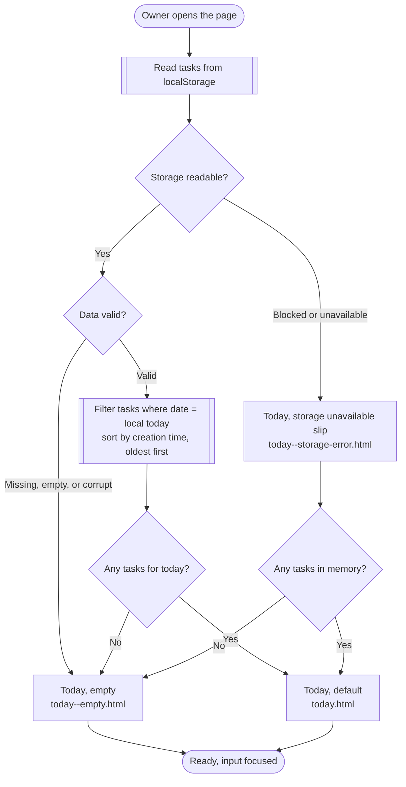
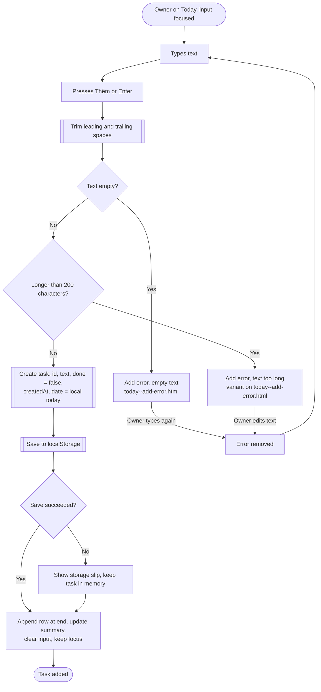
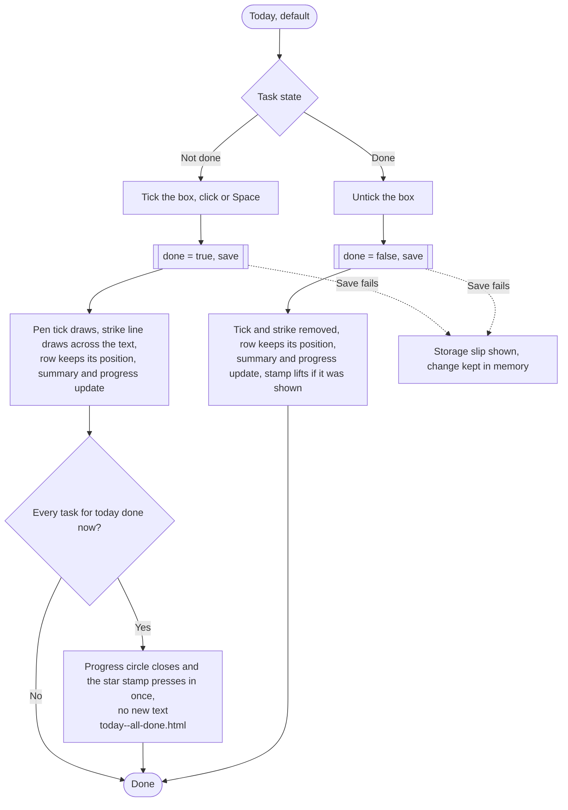
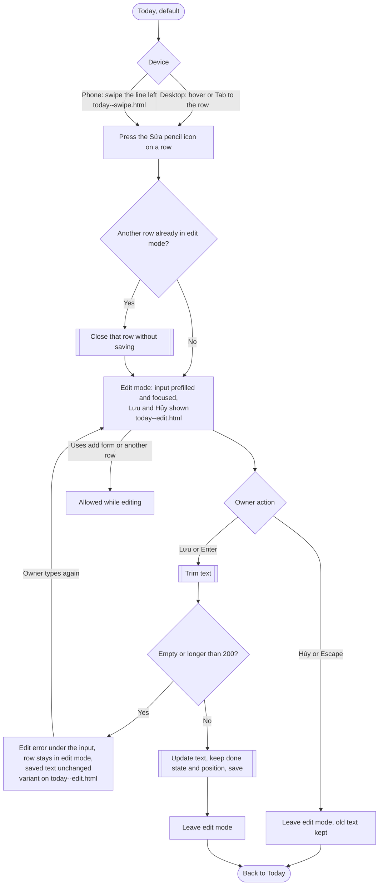
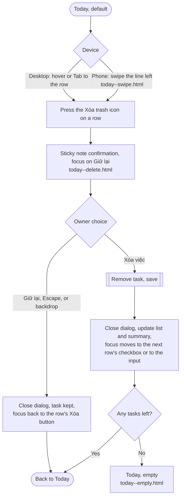
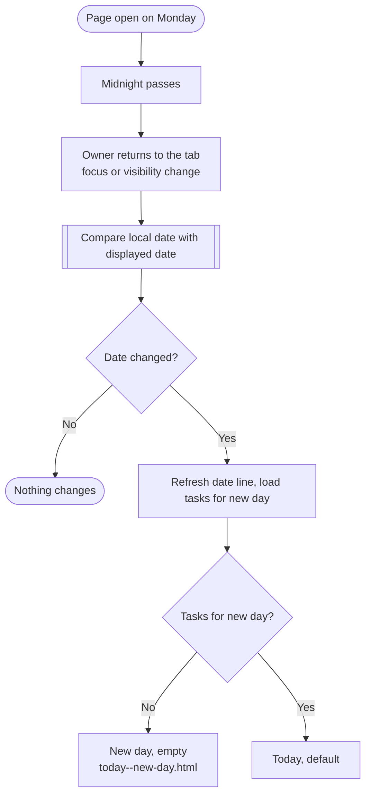

# daily-task-log: user flows and screen inventory

The whole feature lives on one screen, "Việc cần làm hôm nay". The flows below describe how the owner moves between the states of that screen. Prototype files are in `screens/`, and each state named here links to one of them.

## Flow 1: Open the page

Notes: reading localStorage is synchronous and fast, so there is no loading state. The first paint already shows the final state. Corrupt data never shows a technical message (R27).

## Flow 2: Add a task

## Flow 3: Complete or undo a task

## Flow 4: Edit a task

## Flow 5: Delete a task

## Flow 6: Day changes while the page is open

Monday tasks stay stored and are not deleted (R25). If a row was in edit mode when the day changed, the unsaved edit is dropped together with the old list (see open question 3).

## Screen inventory

There is one screen. Its states are listed so the Frontend Developer can see every variation. Each state has light screenshots at 1440 px and 390 px in `screenshots/`; the main states also have dark mode screenshots (`-dark-desktop.png`, `-dark-mobile.png`).

| Screen / state | Purpose | Requirements covered | Entry | Exit | Prototype |
| --- | --- | --- | --- | --- | --- |
| Today, default | Show today's tasks on the ruled sheet with progress, summary and row actions | R1, R2, R4, R5, R6, R9, R11, R12, R22, R23, R24, R28, R29, R30 | Page load with tasks, after add, save, cancel, delete | Edit, delete, add error, day change, all done | `screens/today.html` |
| Row actions revealed | Sửa and Xóa shown: swiped line on phones, hover or focus on desktop | R13, R18, R28, R29 | Swipe left (phone), hover or Tab (desktop) | Press Sửa or Xóa, swipe back, tap elsewhere | `screens/today--swipe.html` |
| All done | Celebrate the finished day with the star stamp, no new text | R5, R11 | Ticking the last open task | Unticking any task lifts the stamp | `screens/today--all-done.html` |
| Today, empty | Invite the first task with a doodle | R3, R27 | Page load with no or unreadable data, last task deleted | Add first task to default | `screens/today--empty.html` |
| Add error | Explain why a task was not added | R7, R8, R10 | Thêm or Enter with empty or over 200 characters | Typing removes the message | `screens/today--add-error.html` (both messages) |
| Edit mode | Change task text in place on a highlighted line | R13, R14, R16, R17 | Sửa on a row | Lưu, Enter, Hủy, Escape, Sửa on another row | `screens/today--edit.html` |
| Edit error | Keep the row in edit mode with a clear message | R15 | Lưu or Enter with invalid text | Typing, Hủy, Escape | variant on `screens/today--edit.html` |
| Delete confirmation | Prevent accidental loss with a sticky note | R18, R19, R20 | Xóa on a row | Xóa việc, Giữ lại, Escape | `screens/today--delete.html` |
| Storage unavailable | Warn that tasks may be lost on reload | R21, R26 | Any failed read or write of localStorage | Slip hides after the next successful save | `screens/today--storage-error.html` |
| New day | Show the new date on a fresh page | R25 | Owner returns after midnight | Add first task | `screens/today--new-day.html` |

States not drawn on purpose:
- Loading: not needed, localStorage is read synchronously before first paint.
- Success toast after add, save, or delete: not needed, the list itself is the confirmation, and the requirements text table has no success messages.

## Interaction specification for the Frontend Developer

All tokens and component classes come from `docs/project/design-system.css` (version 3, "Paper notebook"). Please reuse the classes rather than restyling, and keep every element in the sheet body a multiple of `--rule` tall so text stays on the lines.

- Page structure: `body > .desk > main.sheet`, then `header.app-header` (unruled band) and `.sheet__body` (ruled). The sheet draws its own punched holes and double margin line.
- Grid: header, add form, task rows and the empty state all use the same two column grid (margin column, writing column). Marks go in the margin, words go in the writing column.
- Header: `.app-header__top` holds the `h1` and `.app-header__nav`, the empty slot reserved for day navigation (page turning). Under it the date line in `.washi`, then the progress mark in the margin and the summary "Đã hoàn thành {done}/{total} việc" in a `role="status"` element with the count in semibold. Set `--p` on `.progress` to done divided by total times 100. In the empty state, hide both the progress mark and the summary.
- Celebration: when a tick makes done equal total (and total is above zero), add `.progress--complete` and `.progress--celebrate` to `.progress`. Remove `.progress--celebrate` after about 1 second so it never replays on re-render. On page load with every task already done, add only `.progress--complete` (stamp shown, no animation). Unticking removes both classes.
- Add line: a real `<form>` so Enter submits. Visually hidden label with the placeholder text, the pen icon in the margin is decorative. Do not use `maxlength`, because R8 needs the message and the limit applies after trimming. After a successful add, clear and keep focus on the input and give the new row `.task--enter`. On error, set `aria-invalid="true"` on the input (the underline turns red and nudges once), add the `.field-error` with `role="alert"` on the next line, and link it with `aria-describedby`. Remove both on the next `input` event (R10).
- Task row: native checkbox with `aria-label="Đánh dấu hoàn thành"` and `aria-describedby` pointing to the task text. The text goes in `.task__text > .task__label` (the inline label carries the strike line) and is set with `textContent`, never `innerHTML` (R30). Sửa and Xóa are `<button>` elements (links in the prototype only) with `aria-label="Sửa"` and `aria-label="Xóa"`, the same `aria-describedby`, an inline SVG icon, and an `aria-hidden` `.icon-btn__label` that only shows in swipe mode.
- Row actions on desktop: hidden until hover or `:focus-within`, so Tab always reveals them.
- Row actions on phones (`hover: none` or below 600 px): `.task__swipe` is a horizontal scroll snap container. Swiping left reveals Sửa and Xóa; swiping right or tapping another row closes it (set `scrollLeft = 0` on the other rows when one opens). Keyboard focus on Sửa scrolls the row open on its own. Keep both buttons in the DOM at all times so screen reader users reach them without a gesture. The page itself never scrolls sideways.
- Done style: the pen tick draws, the text turns to `--color-ink-done`, and the strike line draws across every wrapped line. Position never changes (R11). The `:has()` selector handles this without script.
- Edit mode: the row gets `.task--editing` (a highlighter wash), the text becomes a single line `.input` prefilled, focused, caret at the end. Hủy (ghost) and Lưu (primary) sit on the next ruled line on the right; on mobile they share the width. Enter saves, Escape cancels. Opening Sửa on another row cancels the current edit silently. After save or cancel, return focus to that row's Sửa button. An unsaved edit is dropped when the day changes.
- Delete: native `<dialog class="dialog">` with `showModal()` for Escape handling and the focus trap. The confirmation question is the dialog title, and the task text is quoted below in muted ink (`.dialog__quote`). Initial focus on Giữ lại. Order is Giữ lại then Xóa việc, side by side on every width (each button takes half the width on phones). After Xóa việc, play `.task--exit` on the row, then remove it, update the summary and progress, and move focus to the next row's checkbox or to the add input.
- Storage slip: `.alert.alert--warning` with a paperclip icon inside the header band, `role="alert"`, shown while the last read or write failed and hidden after the next successful write.
- Dark mode: automatic through `prefers-color-scheme`; no toggle and no extra markup. Every colour comes from tokens, so components need no dark specific rules.
- Motion: see the motion table in `design-system.md`. Everything is disabled under `prefers-reduced-motion`.

## Coverage check

All requirements R1 to R30 map to at least one state above. R21 to R24 are data rules with no visible UI of their own beyond the storage slip; they are listed against the states where they apply. No requirement is left uncovered.
