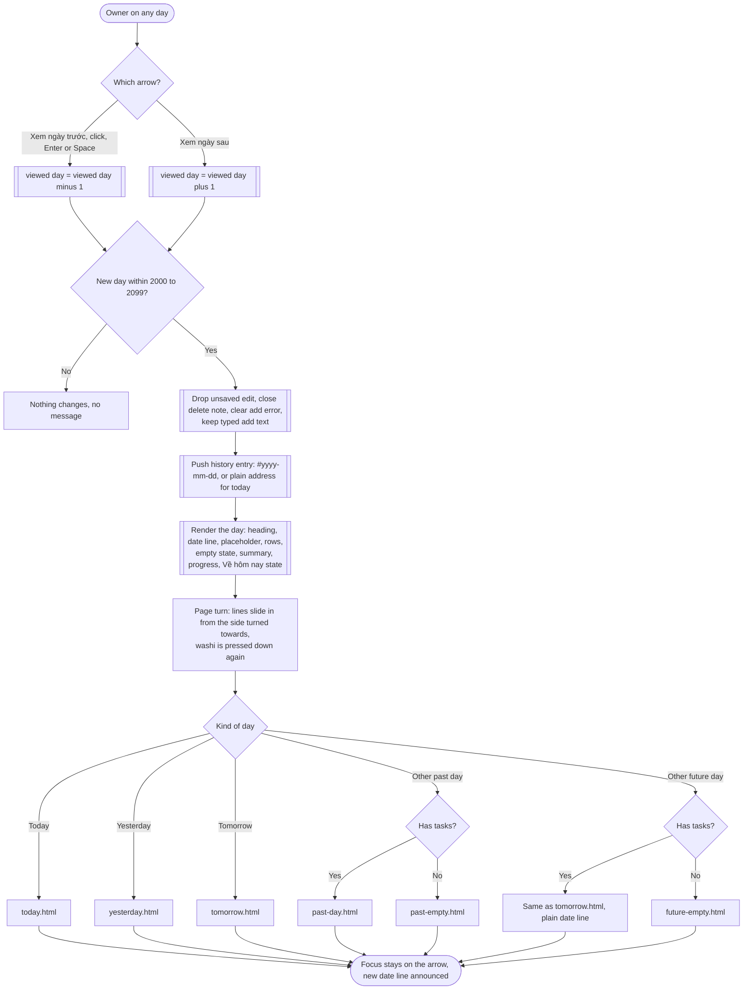
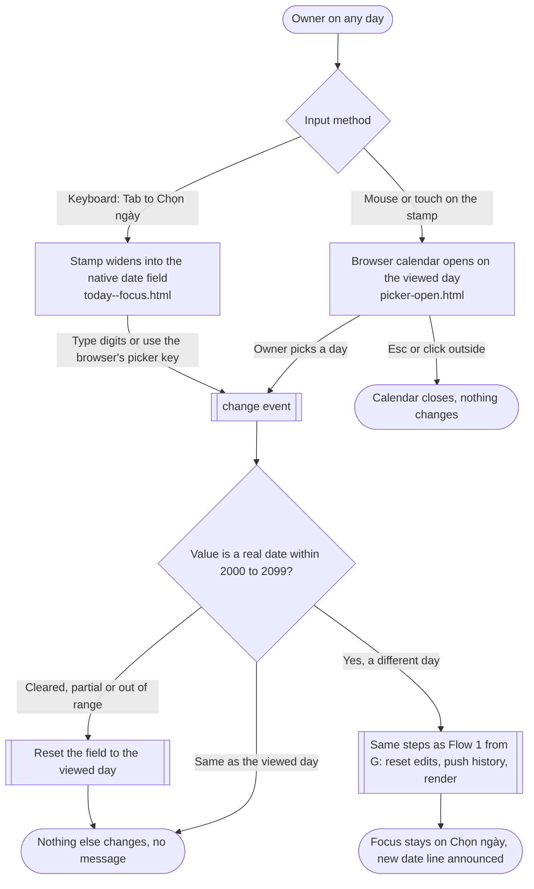
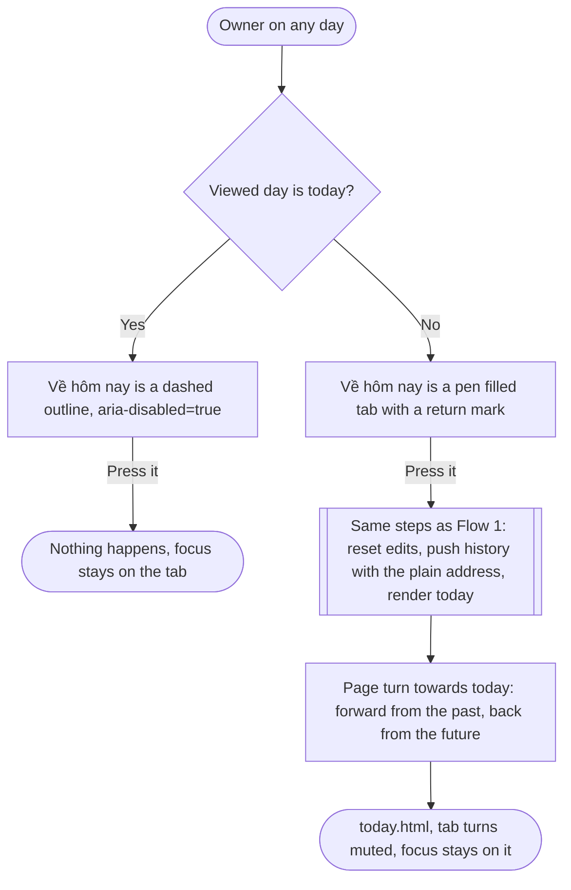
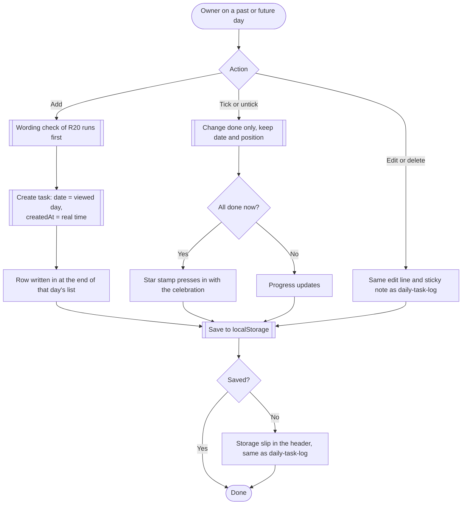
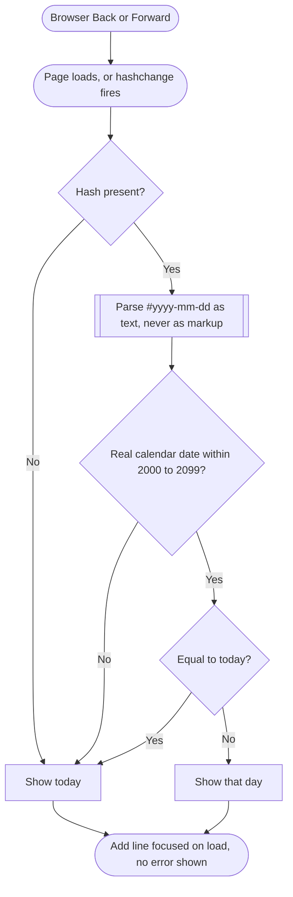
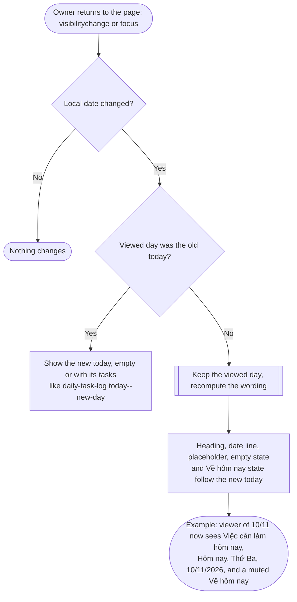

# day-navigation: user flows and screen inventory

Day navigation adds one row to the header of the existing notebook page, and every other part of the screen keeps working as it does in `daily-task-log`. The flows below show how the owner moves between days and what the page does on each move. Every state named here has a prototype file in `screens/`.

## The header, in reading and tab order

1. Heading: "Việc cần làm hôm nay" on today, "Việc cần làm" on any other day.
2. Day navigation row (`<nav class="app-header__nav day-nav">`, moved out of `.app-header__top` into its own header row):
   - Xem ngày trước: a pen chevron icon button, with the accessible name and tooltip "Xem ngày trước".
   - Xem ngày sau: a pen chevron icon button, with the accessible name and tooltip "Xem ngày sau".
   - Chọn ngày: a rubber date stamp wrapping a native `<input type="date" aria-label="Chọn ngày" min="2000-01-01" max="2099-12-31">`, whose value is always the viewed day.
   - Về hôm nay: an index tab. It is pen filled on other days and drawn as a dashed pencil outline on today (`aria-disabled="true"`).
3. Date line on washi tape, with `aria-live="polite"` so that every new date line is announced (R8).
4. Progress mark and summary, unchanged.
5. Add line. Its placeholder and label follow the viewed day.

## Flow 1: Turn one page (previous or next day)

Notes: there is no loading state, because every day is already in memory and the switch is under 100 ms (NFR1). The first paint of a new day is final. When every task of the new day is done, the star stamp shows without the celebration (R14).

## Flow 2: Pick a date

Notes: the arrows step one day at a time, and the stamp jumps to any day. The page has no visible error for a bad picker value, because R9 asks for no change. Resetting the field to the viewed day is what makes the absence of change visible.

## Flow 3: Back to today

## Flow 4: Work on another day

Notes: the add, edit, delete and storage states are unchanged and are not redrawn. The prototype links Sửa, Xóa and the add errors to the approved `daily-task-log` screens. The only differences on other days are the heading, the date line, the placeholder ("Bạn cần làm gì ngày này?") and the empty state wording.

## Flow 5: Load, reload, bookmark and browser Back

Notes: browser Back retraces each day move, because each move pushed one entry (R25). A hash that equals today shows today; whether to also clean the address in that case is left to the architect, since the requirements do not say.

## Flow 6: Midnight passes while the page is open

## Screen inventory

| Screen | Purpose | Requirements | States shown | Entry | Exit |
| --- | --- | --- | --- | --- | --- |
| [today.html](screens/today.html) | Today with day navigation | R4, R5, R6, R10, R11, R13, R27, R28, R29 | Default with tasks; Về hôm nay inactive | Plain address, Về hôm nay, arrows, picker | Arrows, stamp, add and row actions |
| [yesterday.html](screens/yesterday.html) | The day before today, all done | R1, R6, R10, R11, R14 (stamp without animation), R15, R29 | All done, active Về hôm nay | Xem ngày trước from today, picker, `#2026-11-08` | Arrows, Về hôm nay, picker |
| [tomorrow.html](screens/tomorrow.html) | The day after today, planned tasks | R2, R6, R11, R13, R15, R16 | Default with tasks, 0 of 3 done | Xem ngày sau from today, picker | Arrows, Về hôm nay, picker |
| [past-day.html](screens/past-day.html) | A far past day with tasks | R3, R10, R11 (plain date line), R13, R15, R17 | Default with tasks, 3 of 5 done | Picker, bookmark, browser Back | Arrows, Về hôm nay, picker |
| [past-empty.html](screens/past-empty.html) | A past day with no tasks | R12 (past wording), R13 (progress and summary hidden) | Empty, past | Arrows, picker | Add a task, arrows, Về hôm nay |
| [future-empty.html](screens/future-empty.html) | A future day with no tasks | R2, R12 (future wording), R16 | Empty, future | Arrows, picker | Add a task, arrows, Về hôm nay |
| [picker-open.html](screens/picker-open.html) | Date picker open on the viewed day | R3, R9, R27 | Calendar open (stand in for the browser's own) | Click or tap the stamp | Pick a day, Esc |
| [today--focus.html](screens/today--focus.html) | Keyboard focus and tab order | R5, R8, R27 | Focus on each control; inactive and active Về hôm nay | Tab | Enter or Space |

Flows only, with no separate screen: R7 (the reset on day change, Flow 1), R18 (storage, unchanged slip), R19 to R21 (Flow 6), R22 to R26 (Flow 5). The add, edit, delete, error and storage states are the approved `daily-task-log` screens.

## Requirement coverage

| Requirement | Where |
| --- | --- |
| R1 | Flow 1, yesterday.html |
| R2 | Flow 1, tomorrow.html, future-empty.html |
| R3 | Flow 2, picker-open.html, past-day.html |
| R4 | Flow 3, today.html |
| R5 | Flow 3, today.html, today--focus.html |
| R6 | Flow 1, every day screen |
| R7 | Flow 1 step "Drop unsaved edit..." |
| R8 | Flows 1 to 3, date line `aria-live`, today--focus.html |
| R9 | Flow 1 range check, Flow 2 reset, picker `min` and `max` |
| R10 | today, yesterday, tomorrow, past-day |
| R11 | Date lines on today, yesterday, tomorrow, past-day, past-empty, future-empty |
| R12 | past-empty.html, future-empty.html (today empty stays daily-task-log today--empty) |
| R13 | Summaries on all task screens, hidden on empty screens |
| R14 | yesterday.html (stamp without animation), Flow 4 (celebration only on the tick) |
| R15 | Flow 4, Sửa and Xóa links on every day screen |
| R16 | Flow 4, tomorrow.html and future-empty.html notes |
| R17 | Flow 4 |
| R18 | Flow 4 |
| R19, R20 | Flow 6 |
| R21 | Flow 4 (wording check first) |
| R22, R23 | Flow 1 history step, Flow 3 |
| R24 | Flow 5 |
| R25 | Flow 1, Flow 5 |
| R26 | Flow 5 |
| R27 | today--focus.html, header order above |
| R28 | Every control 44 px, verified with no horizontal scroll at 1440, 390 and 360 px |
| R29 | Heading, date line wording and Về hôm nay state on every screen |

## Notes for the Frontend Developer

- Day classes are applied once per move: `turn--back` or `turn--forward` on `.sheet__body`, and `washi--restick` on the date line. Remove them on `animationend`. Reduced motion turns them off.
- The `.date-stamp` wrapper takes `data-tip="Chọn ngày"` for its tooltip and contains a calendar icon and the input. Keep the input value in sync with the viewed day after every move and after a rejected value.
- The inactive Về hôm nay tab is a real `<button aria-disabled="true">`, not `disabled`, so focus is never lost (R5).
- `document.title` follows the heading.
