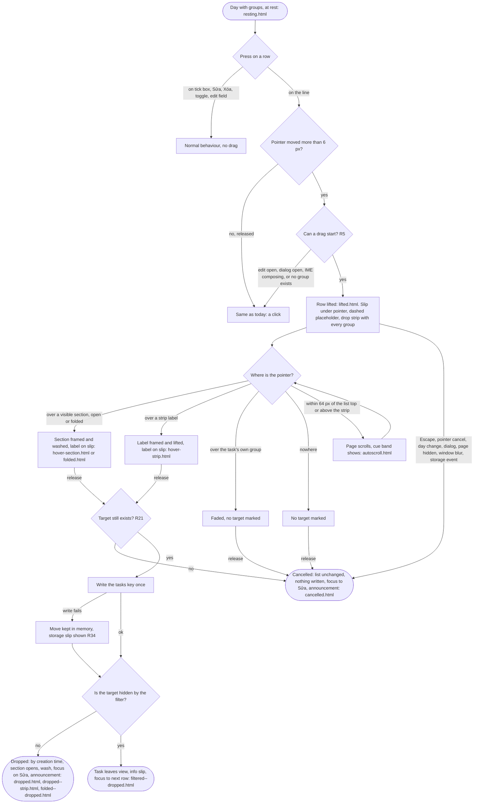
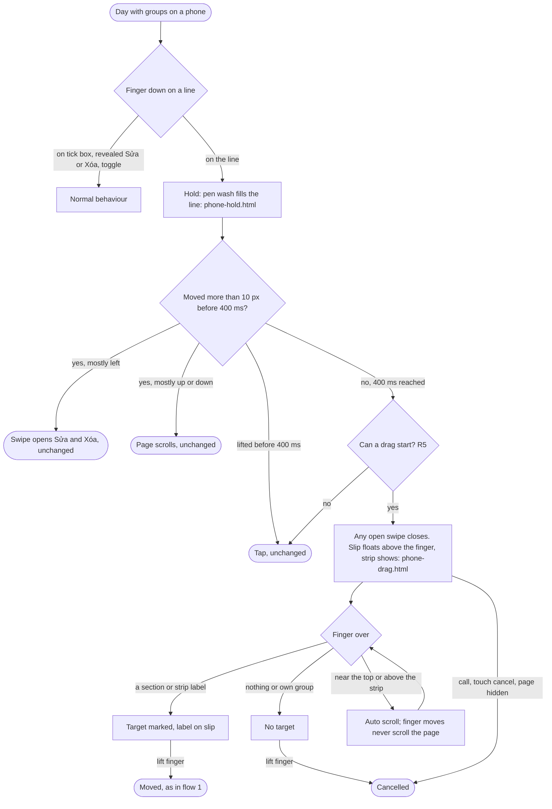
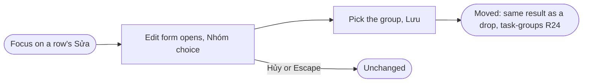

# drag-drop: user flows and screen inventory

The prototype screens are in `screens/`, the review entry is `index.html`, and the new styles are in `docs/project/design-system.css` under "Drag and drop" (described in `design-system.md`). Every drag ends in one of two ways: the task is moved, or nothing changes. There is no third outcome.

## Flow 1: Move a task with a mouse (desktop)

## Flow 2: Move a task with a finger (phone)

## Flow 3: Move without dragging (keyboard, screen reader, single pointer)

This flow is unchanged from task-groups and is the WCAG 2.5.7 alternative (R24, R25). The drop strip is not in the tab order or reading order (R10).

## Screen inventory

| Screen | Purpose | Requirements | States shown | Entry | Exit |
| --- | --- | --- | --- | --- | --- |
| resting.html | Day at rest, nothing new on screen | R10, R26 | default | any day with groups | press and move a line |
| lifted.html | Mouse drag started, pointer over no target | R1, R4, R7, R9, R10, R11, R17, R19, R27, R29 | dragging, no target | resting | hover a target, release, Escape |
| hover-strip.html | Pointer over a strip label (a group with no task today) | R8, R9, R11, R28, R29 | target in strip | lifted | release (dropped--strip) |
| hover-section.html | Pointer over a visible section | R8, R11, R28 | target section | lifted | release (dropped) |
| dropped.html | Task moved into Nhà by creation time | R12, R13, R16, R23, R33, R36, R37 | success, wash, focus, announcement | release on target | none, back at rest |
| dropped--strip.html | Task moved into a group that had no section | R9, R13, R23 | success, new section | release in strip | at rest |
| cancelled.html | Escape, release on nothing or own group, interruption | R11, R12, R18, R20, R21, R22, R36 | cancel, focus, announcement | any drag | at rest |
| phone-hold.html | Long press filling, plus the unchanged swipe for comparison | R2, R3, R6, R7 | pressing, swipe open | finger down | 400 ms (phone-drag) or swipe or scroll |
| phone-drag.html | Touch drag over a strip label | R2, R8, R9, R28, R32 | dragging on a phone | phone-hold | lift finger |
| filtered.html | Filter on Công ty, dragging to hidden Nhà | R9, R15 | target hidden by filter | lifted under filter | release (filtered--dropped) |
| filtered--dropped.html | Task left the view, info slip, focus next row | R15, R23 | success, hidden target | release | at rest |
| folded.html | Hovering a folded section, it does not open | R8, R14 | folded target | lifted | release |
| folded--dropped.html | Folded section opened on drop | R13, R14 | success, section opened | release | at rest |
| autoscroll.html | Long list, auto scroll cue above the strip | R31, R32 | scrolling | dragging near an edge | leave the band, release |

Rules that need no screen of their own: R24 and R25 (Sửa move, unchanged, see task-groups edit-move), R30 (reduced motion: same screens without tilt or motion, styles in design-system.css), R34 (storage failure: the existing storage slip appears with the move kept, as in task-groups), R35 and R5 (a day with no group: resting looks like today and no drag starts), NFR4 (an interrupted drag ends in cancelled.html).

## Coverage

Every requirement R1 to R37 maps to at least one screen or state in the table above or the list under it. No requirement is left uncovered.

## Notes for the Frontend Developer

- The slip (`.drag-slip`) and the strip (`.drop-strip`) are appended to `body` with `position: fixed`, never inside a section, so no section can paint over the slip. In the prototype the slip sits inside sections only to place it statically.
- Place the slip so the grab point stays under the pointer on a mouse, and its bottom edge about 60 px above the finger on touch. Clamp it inside the viewport so it never causes horizontal scroll.
- The auto scroll zone (R31) is measured from the list area: 64 px under the top edge of the screen, and 64 px above the top edge of the strip (not the bottom of the screen), so hovering the strip never scrolls. See open question 1.
- Hit testing uses `document.elementFromPoint` with the slip set to `pointer-events: none` (already in the CSS). A section target is the `.group` element, a strip target is `.drop-target[data-key]`.
- Set `.is-dragging` on `html` for the whole drag and remove it on every exit path (NFR4). Set `touch-action: none` on the row only after the 400 ms hold, so swipe and scroll keep working before that.
- Long press feedback: add `.task--pressing` on touch down and remove it on any exit; under reduced motion the wash shows at once instead of filling.
