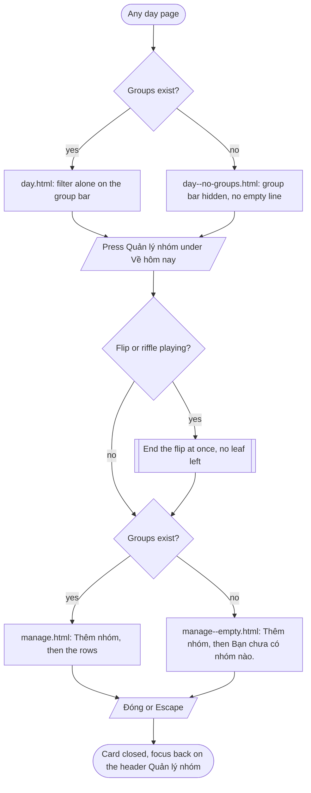
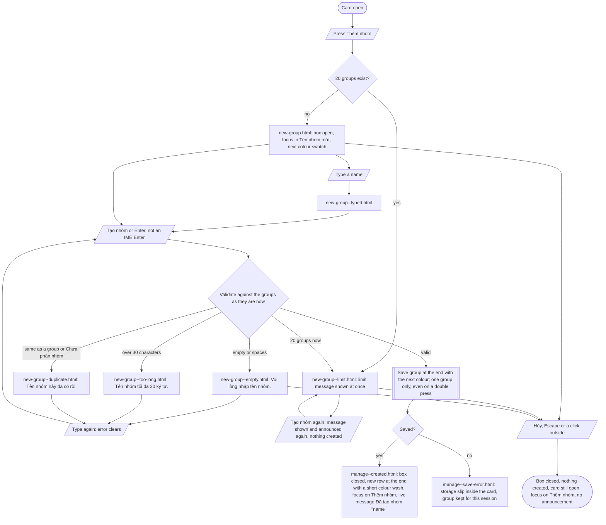
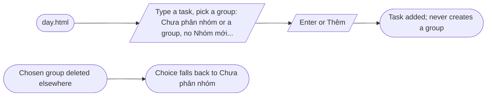

# group-header: user flows and screen inventory

This document maps how the owner reaches "Quản lý nhóm" from the header and creates a group in the new "Tạo nhóm mới" box. Screens live in `screens/`, and the review entry is `index.html`. The box is called "the box" and the "Nhóm việc" dialog "the card", as in requirements.md.

## Flow 1: open the card from the header (R1 to R4, R22 to R24)

Notes: a drag in progress or an open drop strip is cancelled when the card opens (R33). While the card is open no flip starts; a day change from browser Back happens without a flip and the card stays open (R23).

## Flow 2: create a group in the box (R5 to R16, R26 to R30)

System notes:
- The swatch and the corner label show the next colour (`nextColor`), and update if another tab adds a group while the box is open (R7).
- Escape closes only the box, never the card behind it (R10).
- If the card closes, storage fails, or another dialog opens, the box closes and drops the typed text (R11).
- The add form choice, the add input text, an open edit and the filter are not changed by creating a group; the new group appears in the add choice, the filter and the edit choices at once (R19).

## Flow 3: add a task (R18 to R21)

## Screen inventory

| Screen | Purpose | Requirements | States shown | Entry | Exit |
| --- | --- | --- | --- | --- | --- |
| `day.html` | Day page with groups: header with "Quản lý nhóm" under "Về hôm nay", add form without "Nhóm mới...", filter alone on the bar, plus a picture of the open add choice | R1, R3, R4, R18, R21, R24 | default | App load | Quản lý nhóm to `manage.html` |
| `day--no-groups.html` | No groups: group bar hidden, add choice lists only "Chưa phân nhóm" | R1, R4, R18 | empty | App load with no groups | Quản lý nhóm to `manage--empty.html` |
| `manage.html` | Card with "Thêm nhóm" above the rows | R2, R5 | default | Header button | Thêm nhóm, Đóng |
| `manage--empty.html` | Card with no groups | R2, R5 | empty | Header button | Thêm nhóm to `new-group--first.html` |
| `new-group.html` | Box open, empty field, focus in the field, orange swatch and corner label (next colour Cam) | R6, R7, R26 to R30 | default | Thêm nhóm | Tạo nhóm (empty) to `new-group--empty.html`, Hủy |
| `new-group--first.html` | First group: next colour Vàng | R7 | default | Thêm nhóm with no groups | Tạo nhóm to `manage.html` |
| `new-group--typed.html` | Name typed, ready to create | R8, R9 | default | Typing | Tạo nhóm to `manage--created.html` |
| `new-group--empty.html` | Empty name error | R12, R16, R27 | error | Tạo nhóm with nothing typed | Type, Hủy |
| `new-group--too-long.html` | Name over 30 characters, text kept | R13, R30 | error | Tạo nhóm | Type, Hủy |
| `new-group--duplicate.html` | Name already used ("nhà" against "Nhà") | R14 | error | Tạo nhóm | Type, Hủy |
| `new-group--limit.html` | 20 groups: limit message from the start, card still fits the screen | R5, R15, R16 | error (blocking) | Thêm nhóm at 20 groups | Hủy |
| `manage--created.html` | Success: new last row with a colour wash, focus on Thêm nhóm, live message | R8, R19, R31 | success | Valid Tạo nhóm | Đóng |
| `manage--save-error.html` | Storage failed: slip inside the card, group kept for the session | R32 | error | Tạo nhóm with storage failing | Đóng |
| `new-group--keyboard.html` | Phone at 360 by 640 with the on screen keyboard: sheet rides above it | R29, R30 | default | Focus in the field on a phone | Same as the box |

Loading: none. Every step is local and finishes within 100 ms (NFR1), so no loading state is designed; a spinner would only flash.

## Requirement coverage

| Requirement | Screens or states |
| --- | --- |
| R1 to R3 | `day`, `day--no-groups` (every screen shows the header) |
| R4 | `day--no-groups` (bar hidden), `day` (filter alone) |
| R5 | `manage`, `manage--empty`, `new-group--limit` |
| R6, R7 | `new-group`, `new-group--first` |
| R8, R9 | `new-group--typed`, `manage--created` |
| R10, R11 | Hủy links on every box screen return to the card; behaviour in Flow 2 |
| R12 to R16 | `new-group--empty`, `--too-long`, `--duplicate`, `--limit` |
| R17 | Unchanged rename, see the task-groups prototype `manage--edit-error.html` |
| R18 to R21 | `day` (choice list picture), `day--no-groups`, Flow 3 |
| R22 to R25 | Flow 1 notes; the card and box sit above the page in every overlay screen |
| R26 to R28 | Focus shown on `new-group*` (field) and `manage--created` (Thêm nhóm); dialog roles in the markup |
| R29, R30 | `new-group--keyboard`, every box screen at 390 and 360 px |
| R31 | `manage--created` |
| R32 | `manage--save-error` |
| R33 | Flow 1 notes |
