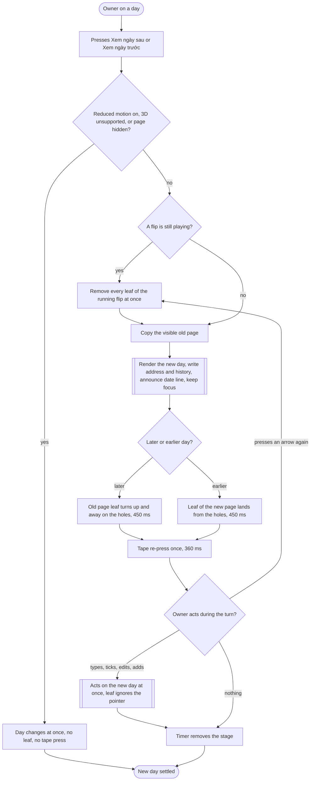
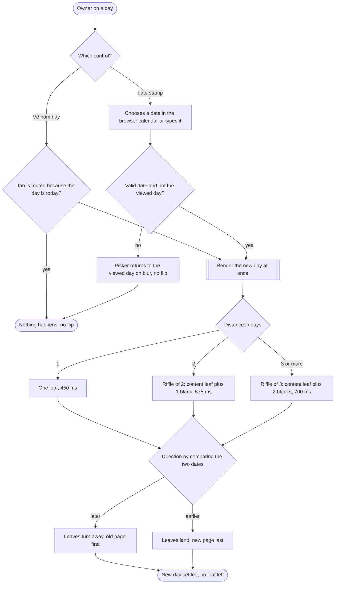
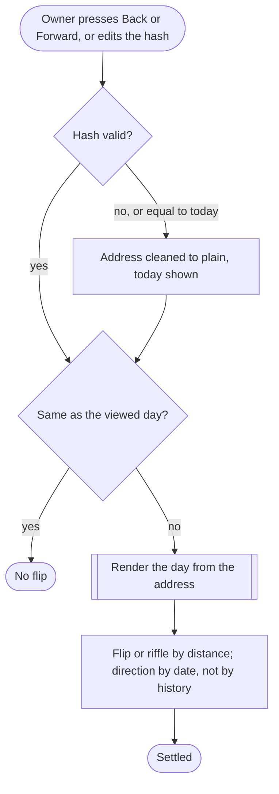
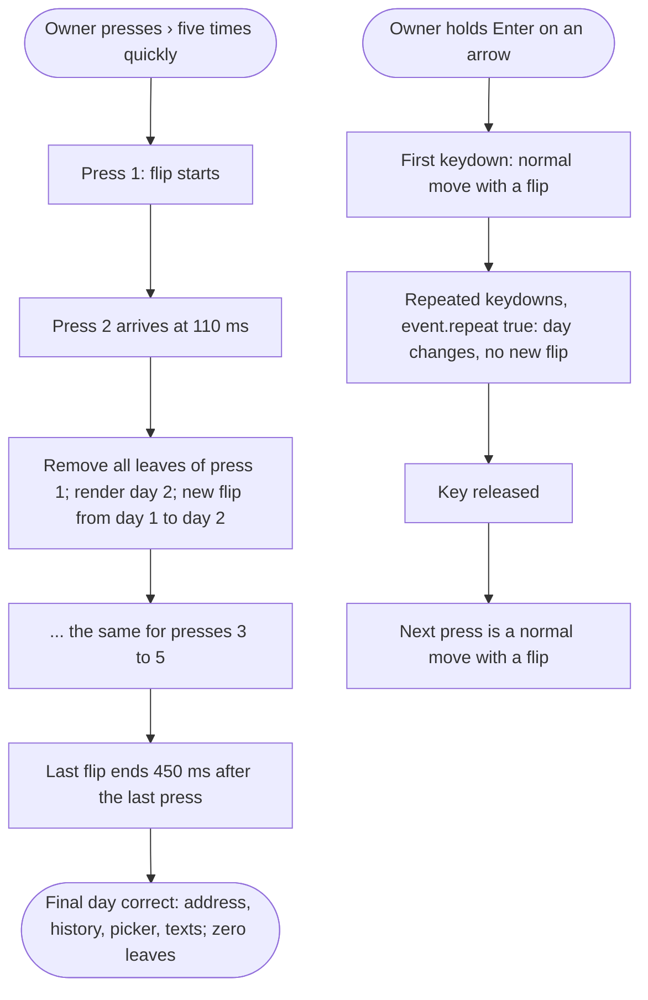
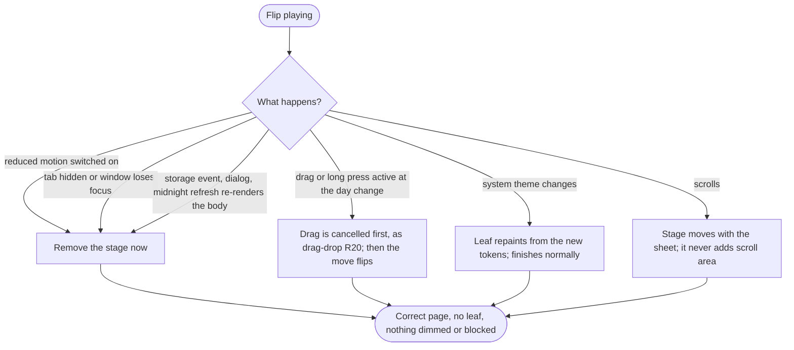

# page-flip UX: flows and screen inventory

The page flip adds no screen and no text. It changes how one moment is drawn: the moment the viewed day changes. All flows below happen on the single app page, so the inventory lists the states of that page during and after a move. The prototype is `screens/flip.html`, and every state below can be reached in it.

## How the motion works (the spec the Frontend Developer builds)

1. The day changes first, all at once: heading, date tape, placeholder, rows, empty state, summary, progress, picker value, address, history entry and the live date line (R10, R18, R19). Focus stays where `day-navigation` R8 puts it.
2. In the same frame, a `.flip-stage` is added to `.sheet`, covering only the part of `.sheet__body` that is in the window (`--flip-top`, `--flip-h`, `--flip-offset` set inline). It is `aria-hidden="true"`, `inert`, `pointer-events: none` and not selectable (R11).
3. The stage holds 1 to 3 leaves (`.leaf`), each with a `.leaf-cast` before it, and `--i` for its start delay (`--i` times `--dur-riffle-step`).
   - Forward (later day): the top leaf holds a copy of the old sheet body (`.leaf__content`, ids removed) and starts first (`--i: 0`); blank leaves (`.leaf--blank`) lie under it and follow.
   - Back (earlier day, `.flip-stage--back`): every animation plays in reverse, so leaves land from the holes onto the page. Blank leaves land first and the leaf with a copy of the new page lands last, on top, so removing it is seamless (R4).
4. Each leaf turns on the punched holes (`transform-origin` at the centre of the hole strip) from flat to 92 degrees with `perspective` on the stage. Past half way the plain darker back (`.leaf__back`) fades in over the text, a shade (`.leaf__shade`) grows towards the free edge, and the cast shadow narrows towards the holes. Only transform and opacity animate.
5. The date tape gets `.washi--restick` once, with the first leaf (R12).
6. The stage is removed by a timer at `--dur-flip + (leaves - 1) * --dur-riffle-step` plus one frame, never by waiting for `animationend` (R9). It is also removed at once by a new move (R14), reduced motion switching on (R29), the page becoming hidden (R38), or any re-render of the sheet body (R37).

Leaf count by distance in calendar days: 1 day gives 1 leaf (450 ms), 2 days give 2 leaves (575 ms), 3 or more give 3 leaves (700 ms).

## Flow 1: turn one page with an arrow (R1, R4, R14, R18, R21 to R24)

## Flow 2: jump with the date picker or Về hôm nay (R2, R3, R3a, R5, R17)

While a date is typed, each valid date the picker reports is its own move, so each one ends the running flip and starts one for its own distance (R17). The final day is the one typed.

## Flow 3: browser Back and Forward or an edited address (R3b, R5, R6)

On page load, reload or opening a bookmark, the day renders with no flip (R6).

## Flow 4: rapid presses and held keys (R14 to R16)

## Flow 5: things that end a flip early (R7, R13, R25, R26, R28, R29, R36 to R39)

## Screen and state inventory

There is one screen, the day page. The states below are what the owner can see. "Prototype" says how to reach each one in `screens/flip.html`.

| State | Purpose | Requirements | Entry | Exit | Prototype |
| --- | --- | --- | --- | --- | --- |
| Settled day (default) | The approved page, exactly as before | R6, R9, R41 | Load, or the end of any flip | Any move | Open the page |
| Flipping forward, 1 leaf | Old page turns away to show a later day | R1, R2, R4, R8, R10, R12 | › arrow, picker or Về hôm nay 1 day later | Timer at 450 ms, or a new move | Press ›; frames in Inspect one frame |
| Flipping back, 1 leaf | Earlier day lands over the page | R1, R2, R4, R8, R10 | ‹ arrow, picker or Về hôm nay 1 day earlier | Timer at 450 ms, or a new move | Press ‹ |
| Riffle of 2 | A 2 day jump | R2, R3, R3a | Picker, Về hôm nay, Back or Forward, 2 days | Timer at 575 ms | "2 days later" |
| Riffle of 3, forward or back | A jump of 3 days or more | R2, R3, R3a, R3b | The same, 3 days or more | Timer at 700 ms | "9 days later", "4 days earlier", Về hôm nay from far away |
| Interrupted | A new move ends the running flip and starts its own | R14, R16, R17 | Any move during a flip | The new flip's end | "5 quick presses on ›" |
| Held key | Day changes with no flip | R15 | Enter held on an arrow | Key released | Hold Enter on ‹ or › |
| Working during a flip | Type, tick, add on the new day | R21 to R24, R27 | Any input during a flip | Not applicable | Tick or type right after a press |
| Reduced motion | Day changes at once, no leaf, no tape press | R28, R29, R39 | System setting on (or no 3D support) | Setting off | "Reduce motion" checkbox |
| Hidden page | Day changes with no flip; a running flip ends | R7, R38 | Tab in the background | Tab visible | Switch tabs during slow motion |
| Dark mode | Charcoal leaf, darker back, visible shadow | R34 to R36 | System theme dark | Not applicable | Set the system to dark |
| Phone, 390 and 360 px | Same flip, same durations, hinge on the left | R13, R30 to R33 | Narrow screen | Not applicable | Open on a phone or resize |

There is no loading, error or empty state of the flip itself: it is cosmetic, and every failure path ends in the settled day (NFR7). The existing empty states ("Hôm nay chưa có việc nào...", "Ngày này chưa có việc nào được ghi lại.") are copied onto the leaf like any other page content.

## Requirement coverage

| Requirement | Where |
| --- | --- |
| R1, R2, R3, R3a | Flows 1 and 2; one leaf, riffle of 2 and riffle of 3 states |
| R3b, R5, R6 | Flow 3; settled state on load |
| R4 | Flipping forward and flipping back states; direction note above |
| R7, R38 | Flow 5; hidden page state |
| R8, R9 | Motion spec steps 2 to 6; storyboard in index.html |
| R10, R18, R19, R20 | Motion spec step 1; stage is aria-hidden and inert |
| R11 | `.flip-stage` attributes and `pointer-events: none` |
| R12 | Tape re-press once per move |
| R13, R33 | Stage clips to the sheet; no horizontal scroll measured at 1440, 390 and 360 px |
| R14 to R17 | Flow 4; interrupted and held key states |
| R21 to R27 | Working during a flip state; Flow 5 for drag and long press |
| R28, R29, R39 | Reduced motion state; `@media (prefers-reduced-motion)` hides any stage |
| R30 to R32 | Phone state; no swipe added |
| R34 to R36 | Dark mode state; leaf tokens in design-system.css |
| R37, R40, R41 | Flow 5; the flip never touches data |
