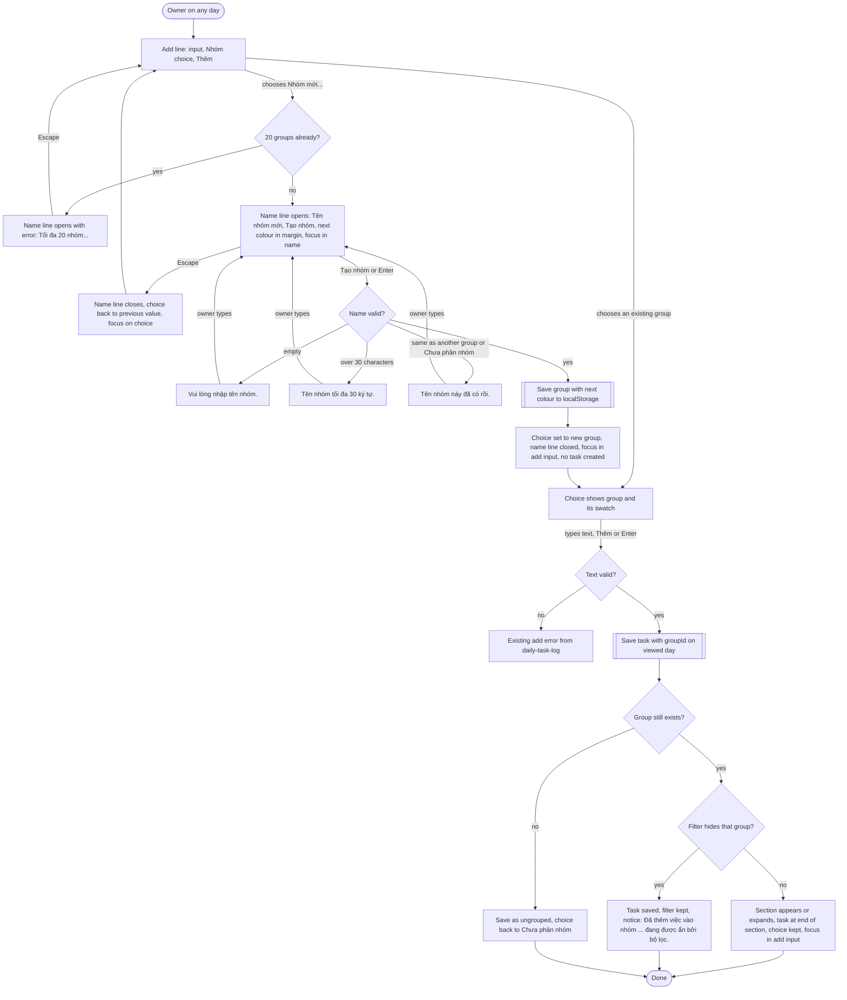
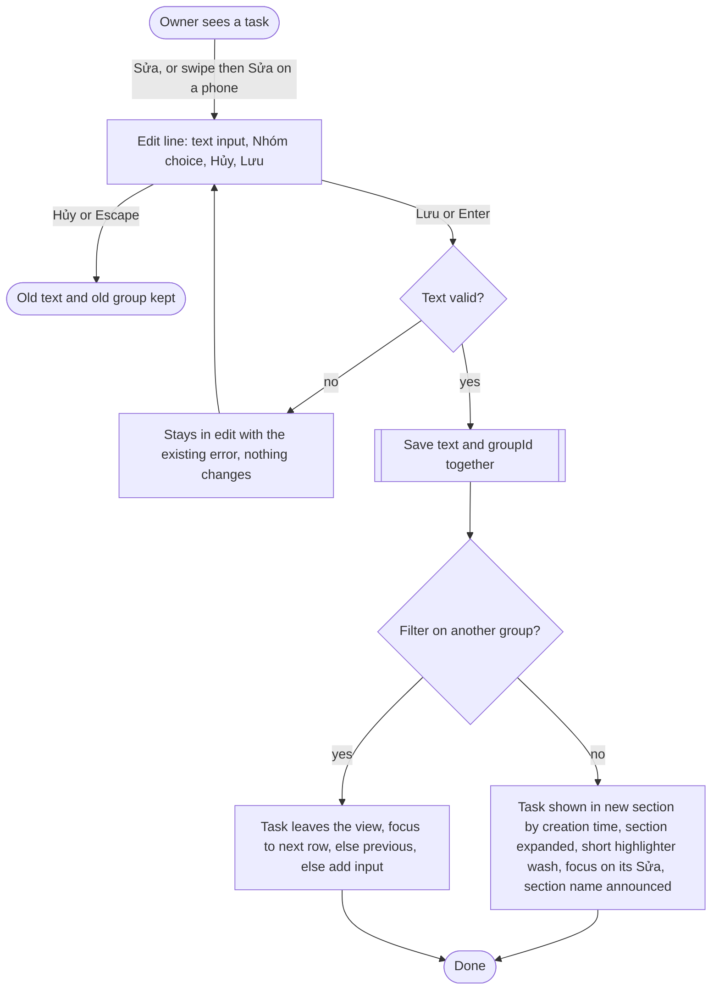
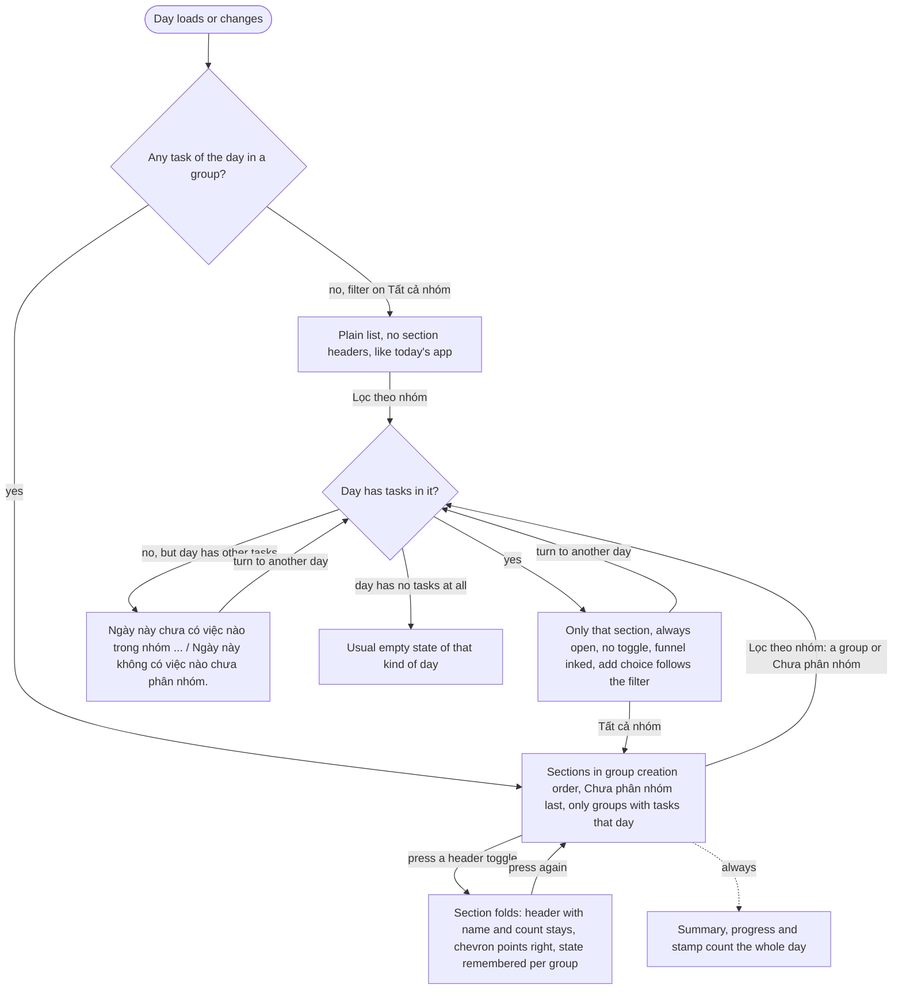
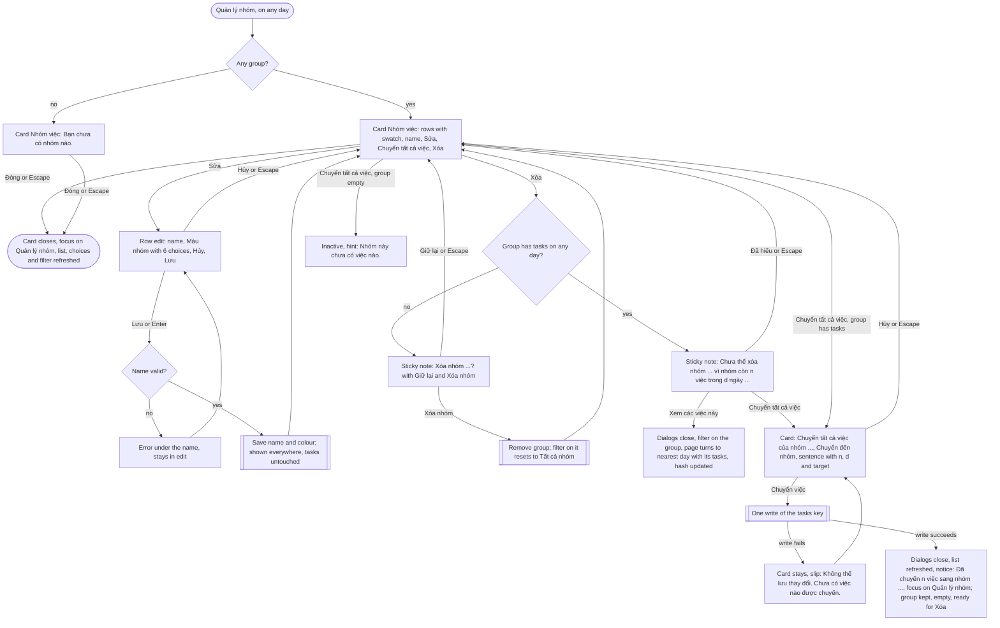

# task-groups: user flows and screen inventory

All screens are in `screens/`, built on the paper notebook design system (v3) with the additions described in `design-system.md`, section "Task groups". Every visible string is Vietnamese and taken word for word from the requirements table; text not in that table is the existing daily-task-log and day-navigation text.

## Flow 1: Create a group while adding a task (R14 to R22)

## Flow 2: Move one task to another group (R23 to R28)

## Flow 3: Read the day by group, fold and filter (R29 to R34, R39 to R50)

## Flow 4: Manage groups (R35 to R38, R51 to R54, R67 to R72)

## Screen inventory

| Screen | Purpose | Requirements | States shown | Entry | Exit |
| --- | --- | --- | --- | --- | --- |
| `no-groups.html` | A day before any group exists; looks like today's app | R14, R31, R35, R42 (no filter), R57 | default | first load after release | Nhóm mới..., Quản lý nhóm |
| `sections.html` | A day with several groups and Chưa phân nhóm | R9, R11, R12, R29, R30, R32, R33, R50, R63, R65 | default, desktop and phone, light and dark | load, day change | fold, filter, Sửa, Quản lý nhóm |
| `sections--collapsed.html` | Nhà folded | R39, R40, R50 | collapsed | header toggle | header toggle |
| `filter.html` | Filter on one group, plus three labelled variants | R41, R42 to R47, R49, R50 | filtered, empty group, empty ungrouped, task added to a hidden group (notice) | Lọc theo nhóm | Tất cả nhóm |
| `add-new-group.html` | Nhóm mới... open in the add line, plus four error variants | R3 to R8, R10, R15, R17, R18 | default, empty, too long, duplicate, 20 groups | Nhóm mới... | Tạo nhóm, Escape |
| `add-new-group--created.html` | Group created and chosen, no task yet | R16 | success | Tạo nhóm | Thêm |
| `add-new-group--added.html` | Task added to the new group | R19, R20, R22, R29 | success | Thêm | any |
| `edit-move.html` | Edit line with group choice | R23, R25, R26, R27 | editing | Sửa | Lưu, Hủy |
| `edit-move--saved.html` | Task moved, placed by creation time | R24, R28, R32 | success, focus on Sửa | Lưu | any |
| `swipe.html` | Phone swipe inside a section | R64 | row revealed | swipe left | tap elsewhere |
| `manage--empty.html` | Nhóm việc with no group | R35 | empty | Quản lý nhóm | Đóng |
| `manage.html` | Nhóm việc with four groups | R35, R62, R67 (inactive move) | default | Quản lý nhóm | Sửa, Chuyển tất cả việc, Xóa, Đóng |
| `manage--edit.html` | Rename and recolour | R13, R36, R37 | editing | Sửa | Lưu, Hủy |
| `manage--edit-error.html` | Rename error | R4 to R6, R8 | error | Lưu | typing |
| `manage--delete.html` | Delete an empty group | R51, R48 | confirm | Xóa | Xóa nhóm, Giữ lại |
| `manage--blocked.html` | Delete blocked | R52, R54, R67 | blocked | Xóa | Chuyển tất cả việc, Xem các việc này, Đã hiểu |
| `show-tasks.html` | Xem các việc này result | R53, R45, R46 | filtered on a past day | Xem các việc này | any |
| `move-all.html` | Move every task of a group | R68, R69 | default with target chosen | Chuyển tất cả việc | Chuyển việc, Hủy |
| `move-all--error.html` | Move failed to save | R70, R61 | error | Chuyển việc | retry, Hủy |
| `move-all--done.html` | Move succeeded | R71, R72 | success notice | Chuyển việc | any |

Loading: the app reads localStorage synchronously, so there is no loading state, as in the earlier features.

## Requirement coverage

| Requirement | Screens or states |
| --- | --- |
| R1, R2 | all screens (one group per task, list in creation order) |
| R3 | add-new-group (name kept as typed, trimmed), manage--edit |
| R4 to R8 | add-new-group error variants, manage--edit-error |
| R9 to R13 | sections (light and dark), manage--edit (six choices with names), design-system.md contrast table |
| R14 to R18 | no-groups, add-new-group, add-new-group--created |
| R19 to R22 | add-new-group--added, filter (notice variant) |
| R23 to R28 | edit-move, edit-move--saved |
| R29 to R34 | sections, no-groups (R31), show-tasks (R34 on another day) |
| R35 to R38 | manage, manage--empty, manage--edit |
| R39 to R41 | sections--collapsed, filter |
| R42 to R49 | filter and its variants, show-tasks, manage--delete (R48 reset) |
| R50 | every screen with tasks (summary counts the whole day) |
| R51 to R54 | manage--delete, manage--blocked, show-tasks |
| R55 to R61 | behaviour only; R61 storage message is the existing slip, R70 error shown in move-all--error |
| R62, R63 | keyboard and headings described in design-system.md; toggles are buttons inside h2 |
| R64 | every screen at 390 px and 360 px, swipe |
| R65 | names are plain text (prototype escapes them) |
| R66 | light and dark captures of every screen |
| R67 to R72 | manage (inactive move), manage--blocked, move-all, move-all--error, move-all--done |
